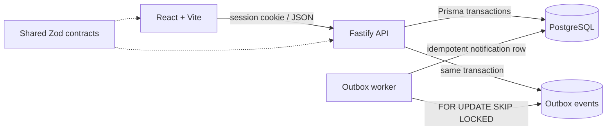

# OpsDesk

OpsDesk is an internal workspace for teams handling customer issues, incidents, payment investigations, compliance requests, approvals, and operational tasks. It keeps ownership, priority, status, comments, and the audit trail with each item. The API checks team membership and role on every resource request; edits use optimistic versions, claims use one conditional database update, and retryable writes use idempotency keys. PostgreSQL is the source of truth for the application and its transactional outbox.



## Prerequisites

- Node.js 20.19 or newer
- pnpm 10 (or Corepack enabled)
- Docker with Docker Compose

## Local setup

Run from the repository root. The commands below work in PowerShell; use `cp .env.example .env` in a POSIX shell.

```powershell
Copy-Item .env.example .env
docker compose up -d db
pnpm install
pnpm db:generate
pnpm db:migrate
pnpm db:seed
pnpm dev
```

Open <http://localhost:5173>. `pnpm dev` starts the API on port 3000, the Vite client on port 5173, and the outbox worker; Vite proxies `/api` requests to Fastify. If you prefer separate terminals, use `pnpm dev:api`, `pnpm dev:web`, and `pnpm worker`.

The Docker initialization script creates `opsdesk_test` for the PostgreSQL integration suite. It runs only when the Docker volume is initialized for the first time. If you already had the volume before adding the test database, create it once with:

```powershell
docker compose exec db psql -U opsdesk -d opsdesk -c "CREATE DATABASE opsdesk_test OWNER opsdesk;"
```

Set `TEST_DATABASE_URL` in `.env` to a disposable PostgreSQL database. The example value points to `opsdesk_test`. The integration suite applies migrations to that database and leaves its randomized fixtures there. It does not delete audit events.

## Demo accounts

Every seeded account uses the password set by `SEED_PASSWORD` (default `opsdesk-demo`).

| Email                   | Team roles                                  |
| ----------------------- | ------------------------------------------- |
| `alex@opsdesk.local`    | Operations admin, Payments member           |
| `blair@opsdesk.local`   | Payments admin, Trust & Compliance viewer   |
| `casey@opsdesk.local`   | Operations member                           |
| `devon@opsdesk.local`   | Payments member, Operations viewer          |
| `emery@opsdesk.local`   | Trust & Compliance member, Payments viewer  |
| `frankie@opsdesk.local` | Trust & Compliance member                   |
| `gray@opsdesk.local`    | Operations viewer, Payments viewer          |
| `harper@opsdesk.local`  | Operations member, Trust & Compliance admin |

## 60-second concurrent-claim demo

1. Start `pnpm dev`.
2. Open the app in two separate browser profiles (or one normal and one private window). Sign in as `casey@opsdesk.local` in one and `harper@opsdesk.local` in the other.
3. In Casey's window, create an Operations item with a distinctive title such as `Concurrent claim demo` and leave it unassigned.
4. In both windows, search for that title and open the item. Wait until both details show the same version.
5. Click **Claim this item** in both windows. One claim succeeds. The other receives `409 CONFLICT_CLAIM`, shows “Someone else claimed this work item,” and refreshes the current item.

## Tests and builds

```powershell
pnpm test
pnpm build
pnpm lint
```

`pnpm test` runs policy and workflow unit tests, PostgreSQL integration tests through Supertest, and React Testing Library tests. The API integration setup runs `prisma migrate deploy` against `TEST_DATABASE_URL`. When no database URL is configured, the PostgreSQL suite is reported as skipped; the pure unit and UI tests still run.

Useful database commands:

- `pnpm db:generate` regenerates Prisma Client.
- `pnpm db:migrate` deploys checked-in migrations.
- `pnpm db:migrate:dev` creates a development migration.
- `pnpm db:seed` inserts the three teams, eight demo users, 150 work items, comments, and history.

## Project notes

- [Engineering decisions](ENGINEERING_DECISIONS.md) describes the main trade-offs.
- [Known limitations](KNOWN_LIMITATIONS.md) lists intentionally deferred work.
