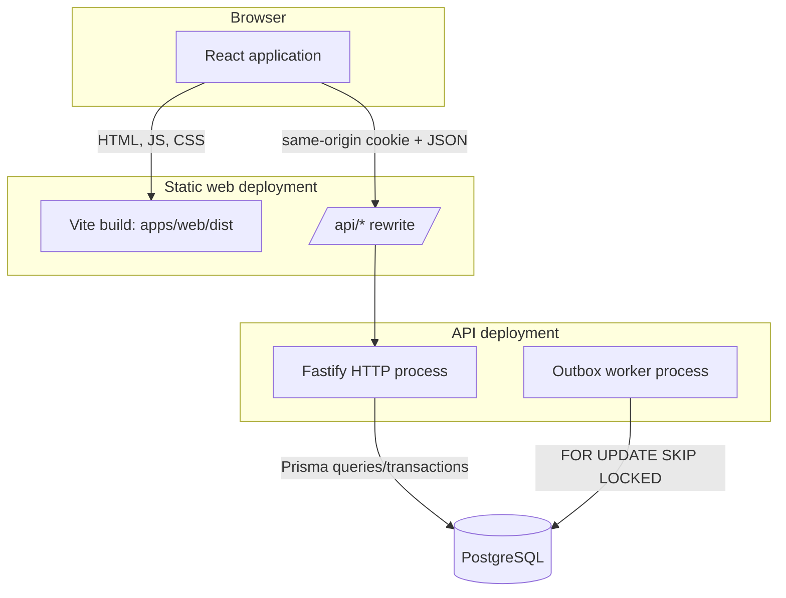
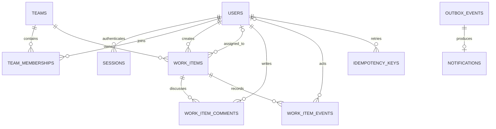
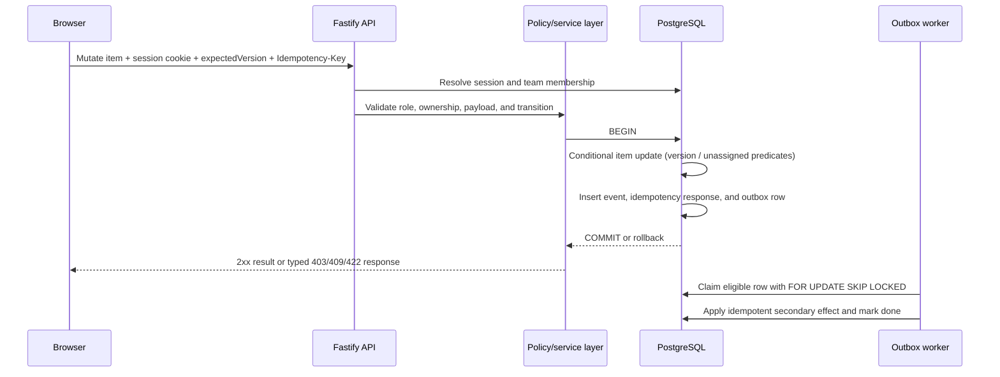

# Architecture

## Runtime boundaries

The browser receives only public static assets and calls `/api/*` on its own origin. Vercel forwards those requests to the Fastify service. PostgreSQL credentials and session HMAC material exist only in the API/worker environment. `pnpm start` runs the API and worker as supervised child processes in one Render web service for a review deployment; `pnpm --filter @opsdesk/api start` and `start:worker` can run separately on hosts that support an always-on background worker.

## Data relationships

## Work-item mutation flow

If a claim loses a race, its conditional update affects zero rows and the API returns `409 CONFLICT_CLAIM` with the current item. If an edit carries an old version, the API returns `409 CONFLICT_VERSION` with the latest item. The frontend can reload that version and let the user reapply the intended change. Repeating a mutation with the same user, endpoint, idempotency key, and request body returns the stored response; using the key with a different body returns a conflict.

## Data ownership and security

- `users` own session rows; memberships are unique per user/team pair.
- Every work item has one team, a creator, optional assignee, comments, and events.
- A team membership is resolved from the stored item/team relationship. A caller-supplied team ID never decides access to an existing item.
- The API policy module is the authorization boundary. `viewer` is read-only; members can create/comment/claim and edit/transition their own assigned work; admins can assign and manage broader transitions.
- Session cookies are HTTP-only, same-site strict, and secure in production. Only a hash of each random session token is persisted.
- Event rows are written in the same transaction as important changes and have database triggers that reject update/delete/truncate operations.
- The client uses shared Zod schemas for payload shape, but the API validates every request again.

The project does not expose the database to browsers and does not use Supabase RLS. If a future deployment adds a direct database client, it must add and verify database-level row policies before shipping.

## Query behavior

Work lists are restricted to the caller's team IDs before query execution. The API applies filters and search in PostgreSQL, requests `limit + 1` rows, and returns a cursor with the last `(updated_at, id)` key and a snapshot timestamp. The maximum list page is 100. History has a separate cursor and does not load an item's entire event stream by default. Trigram indexes support title/description substring search.

## Failure handling

- Database transaction failure rolls back the item change, event, idempotency response, and outbox enqueue together.
- A worker claims rows using `FOR UPDATE SKIP LOCKED`, so multiple workers do not claim the same pending row concurrently.
- A handler failure rolls back its transaction, increments attempts, and reschedules with bounded exponential backoff. After the configured attempt count the row is marked failed.
- Notification effects are upserted by outbox event ID so retrying the same event cannot duplicate the row.
- The API sends typed JSON errors and does not return stack traces or Prisma internals to the browser.
